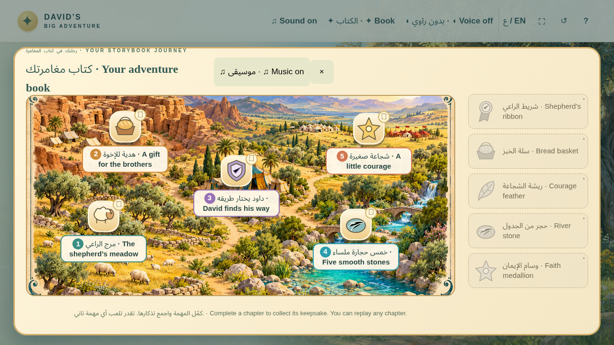
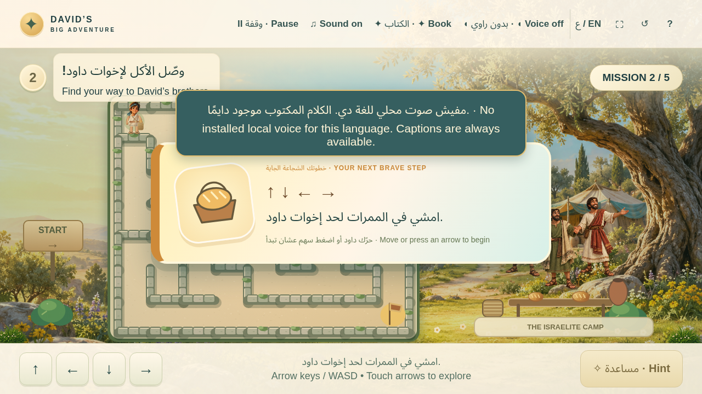
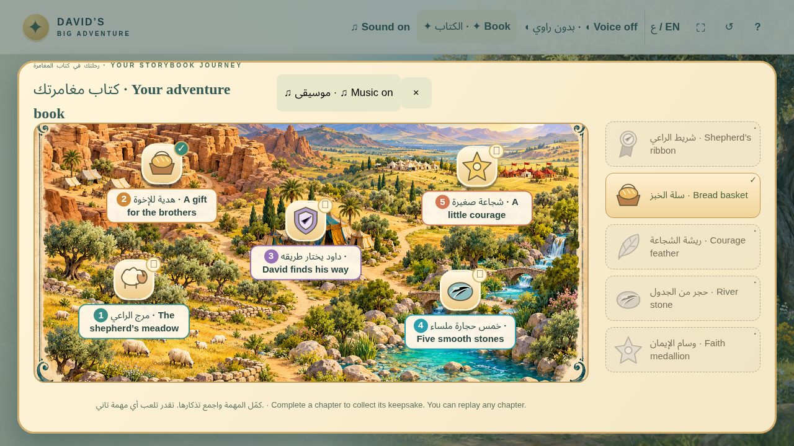
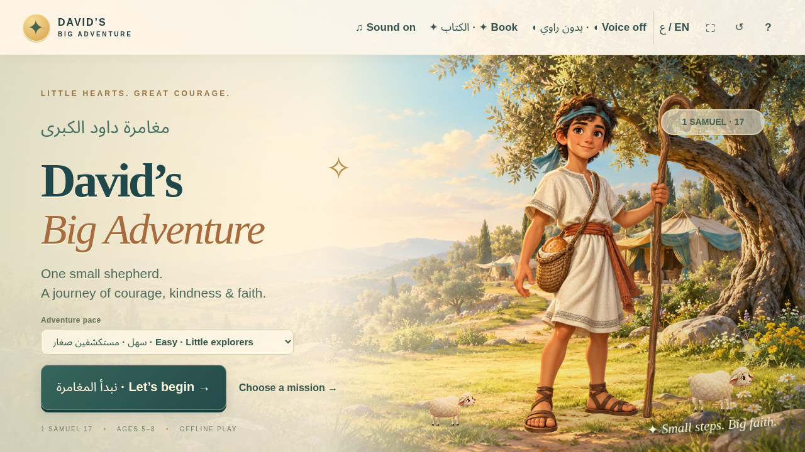
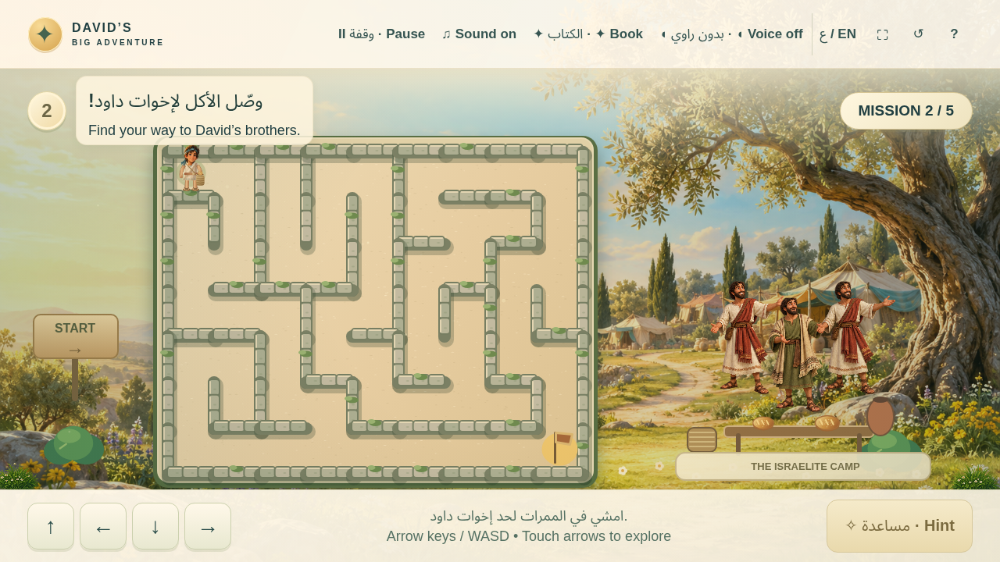
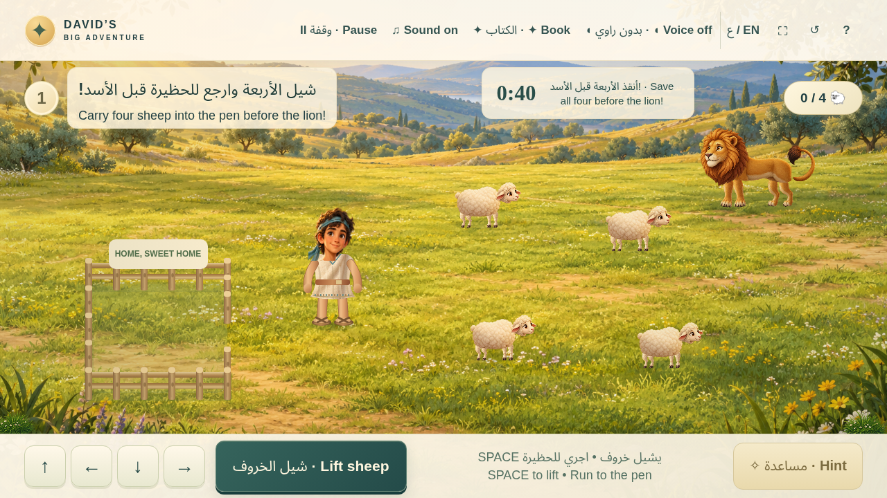
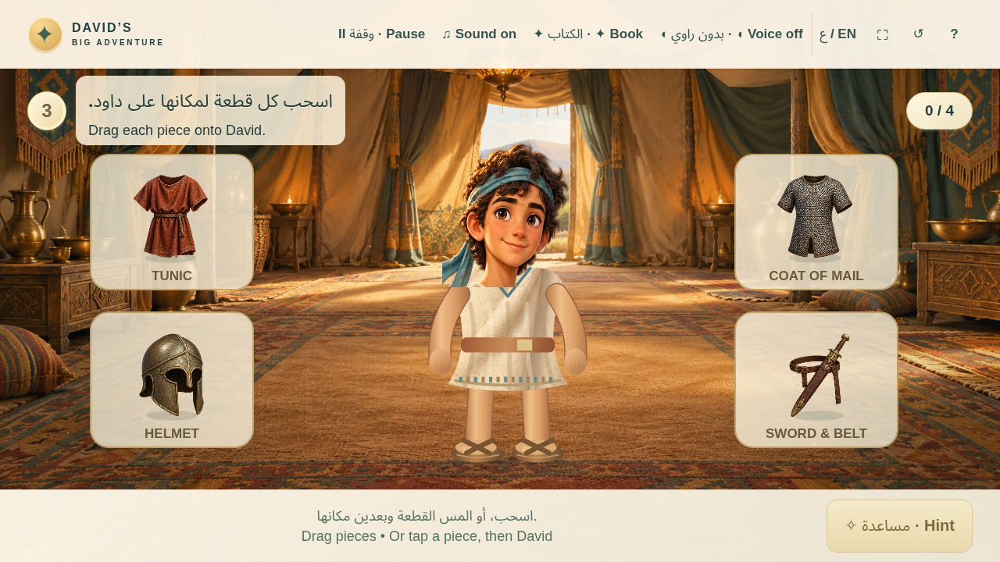
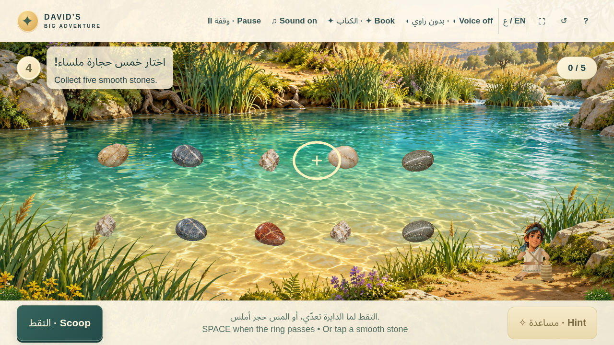
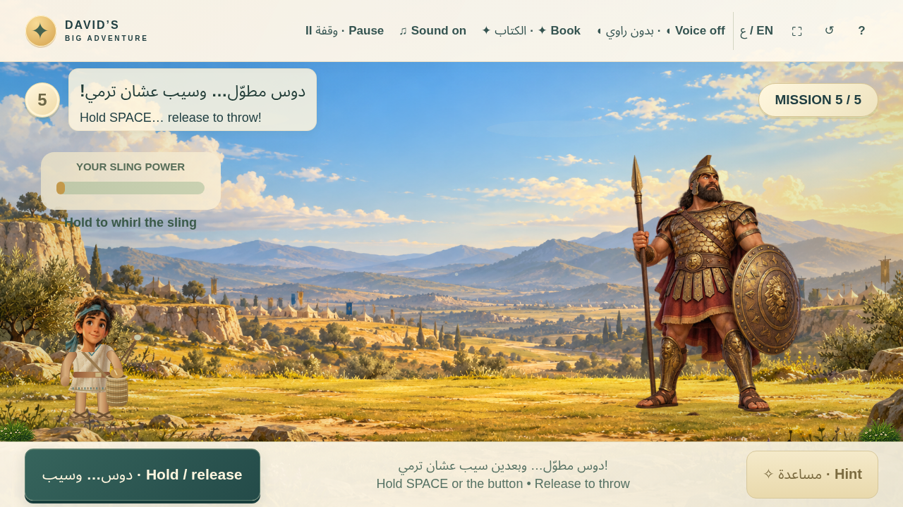

# David’s Big Adventure

An original illustrated five-mission Bible adventure for ages 5–8, built with
TypeScript, Phaser 3 and Vite. Arabic + English captions, mouse/keyboard/touch,
teacher controls and fully bundled illustrated artwork and procedural audio.

## Storybook edition · 1.4

The five chapters now share an illustrated adventure map, earned keepsakes,
colourful instruction cards, a poseable illustration-based David, layered scenery,
action particles and cinematic payoffs. Soft instrumental music, environmental
sound and optional installed local narration support the captions.

The sheep rescue has a **40-second limit** in Easy and Normal, with warnings at
30 and 15 seconds. David runs faster while carrying; the timer waits through the
opening instruction card. Free Play remains untimed. Space or **Lift sheep** raises
one sheep into David’s hands; entering the pen triggers a gentle set-down.





**Book** pauses play while open. A chapter earns its keepsake only after its real
completion and celebration; progress is saved locally when browser storage is
available. **Voice** uses an installed local English or Arabic voice. Captions stay
available if no voice is installed. **Music** can be toggled separately in the book.

Human child playtesting has not been conducted here. A supervised worksheet and
observation guide are included in [docs/CHILD_PLAYTEST.md](docs/CHILD_PLAYTEST.md)
and in the teacher help menu.

## Storybook artwork

All five games now share richer illustrated settings: the olive meadow, food maze,
royal armour tent, clear brook and wide battlefield. Sheep and lion have detailed
animated components; David combines an illustrated face and linen texture with
his poseable rig. Goliath, Saul, the brothers, armour and mineral stones have
original artwork. See [visual design notes](docs/VISUAL_DESIGN.md).








## Play

Extract `Davids_Big_Adventure_Offline.zip` and open `index.html` in Chrome or Edge.
No installation, account or internet connection is needed by the distribution.
See [README_FOR_TEACHER.md](README_FOR_TEACHER.md) for controls and classroom guidance.

## Develop

Node.js 22.12+ (tested with 24.19.0), npm:

```sh
npm ci
npm run dev
```

Open the address Vite prints (default port 5173). The development server listens on
all interfaces for hosted previews and tablet testing on a trusted local network.

```sh
npm test
npm run build
npm run preview
npm run test:browser
```

Visual/QA screenshots are packaged separately in `Davids_Big_Adventure_QA.zip`;
the playable ZIP contains the complete game without the screenshot bundle.

Browser checks require Chromium. In this environment it is `/usr/bin/chromium`.
Set `CHROMIUM_PATH` to another installed Chromium binary when running elsewhere.
`npm run test:browser` starts its own temporary HTTP server on port 4174, tests the
production bundle using real input events, writes evidence into `qa/`, and stops
that server. It also checks the self-contained HTML with networking disabled.
The runner uses two independent browser workers. Set `BROWSER_WORKERS=1` on smaller machines. Do not run two copies of the browser suite concurrently.

`dist/index.html` contains all CSS, original art, audio code and the Phaser bundle
in a classic script. It uses no runtime imports, fetches, CDN assets or service
worker. `npm run build` regenerates it; no server is part of the final package.

## Source map

- `src/model.ts`: deterministic gameplay and collision models.
- `src/world.ts`: authoritative mission/phase state machine, Phaser loop/input,
  scene rendering and staged success animations.
- `src/art.ts`: editable original Canvas illustrations and character rigs.
- `src/scenery.ts`, `src/assets/`: cached maze painting and locally embedded cover illustrations.
- `src/strings.ts`: narrative strings and localization.
- `src/main.ts`, `src/style.css`: scaled accessible HTML UI and teacher controls.
- `src/audio.ts`: gesture-initialized Web Audio effects and stingers.
- `tests/`: automated gameplay model tests.
- `scripts/`: self-contained build, browser gameplay tests and delivery packaging.
- `docs/IMPLEMENTATION.md`: milestones, architecture and final illustration specs.
- `TEST_REPORT.md`: exact evidence and remaining platform/human checks.

Append `?qa` to enable a **read-only** state inspector for browser tests. It cannot
skip missions, move characters, equip pieces or force success. It is absent by
default. Settings and game progress do not require browser storage.

The armour tumble is a playful dramatization: David was unfamiliar with Saul’s
armour, not inherently weak. The sling has two cords and a pouch. Only a physical
forehead/head collision unlocks the canonical victory.
